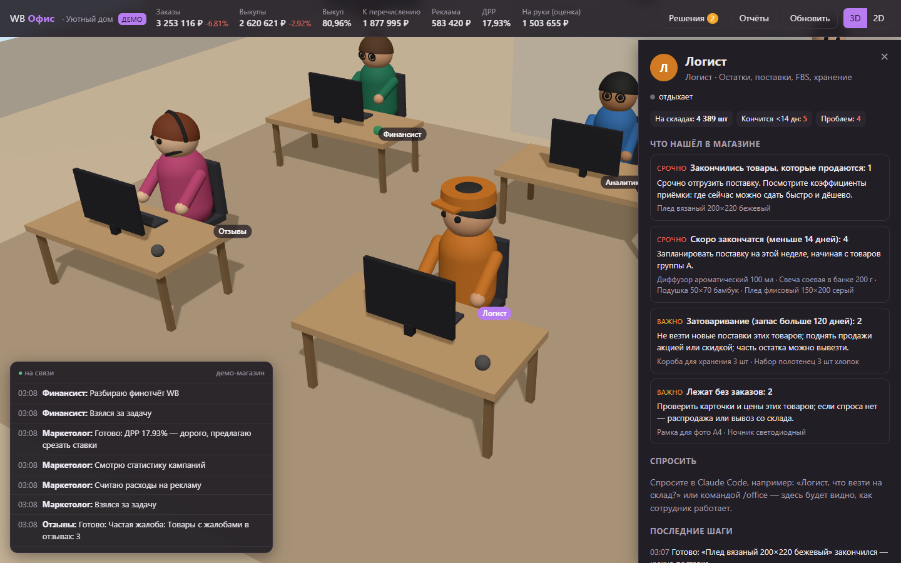
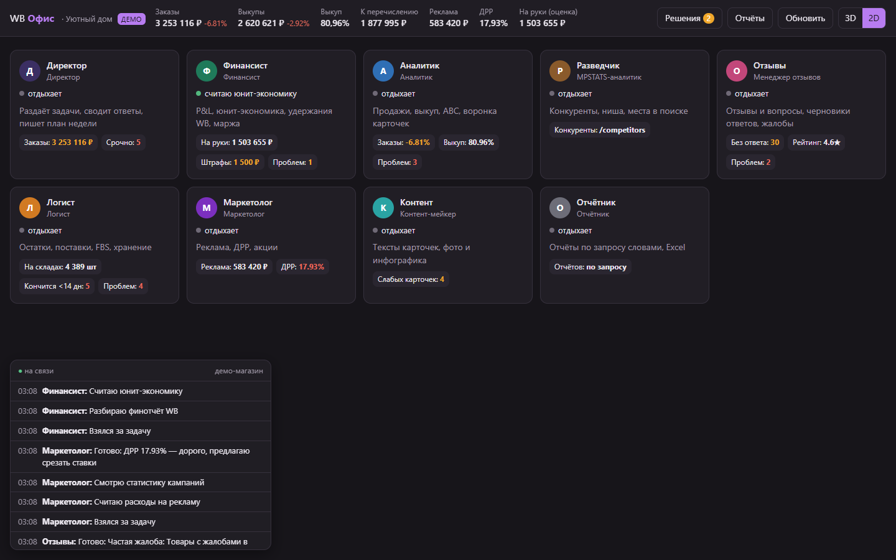

# wb-kit

Помощник продавца Wildberries для [Claude Code](https://claude.com/claude-code). Подключаете ключ от кабинета WB — и спрашиваете обычными словами:

> «Как продажи за последние 30 дней? Сделай ABC-анализ.»
> «Сколько WB удержал с меня за октябрь и на что?»
> «Какие товары скоро закончатся на складах?»
> «Покажи отзывы без ответа и предложи ответы.»

Claude сам сходит в API Wildberries, посчитает и ответит таблицей с выводами. Все команды набора — `/wb`.

## Аудит кабинета за 5 минут

```
/audit
```

Claude соберёт данные за 30 дней и сделает отчёт: продажи и динамика по неделям, ABC-анализ, остатки и сколько дней их хватит, деньги по отчёту WB (комиссия, логистика, хранение, штрафы), воронка карточек, жалобы в отзывах, реклама и ДРР. В начале — главные выводы и план на неделю, дальше — все найденные проблемы по срочности с конкретными товарами.

Результат — HTML-отчёт (открывается двойным щелчком, можно переслать) и Excel со всеми таблицами, в папке `reports/`.

Посмотреть без ключа, на выдуманном магазине: `/audit демо` или [пример отчёта](docs/demo-audit.html).

## Конкуренты

```
/competitors плед флисовый, плед 200х220
```

Claude откроет поиск WB в браузере, как обычный покупатель, и возьмёт первую сотню карточек по каждому запросу. Дальше сравнит с вашими товарами: на каком вы месте, дороже ли лидеров, сколько у них отзывов, фото, какой длины описание, участвуют ли в акциях. Вывод — что поправить в первую очередь. При повторной проверке видно, что изменилось: ваши позиции, новые лидеры, цены конкурентов.

Нужен браузер: расширение Claude для Chrome или встроенный браузер приложения Claude. Ключ WB нужен только чтобы найти ваши товары; без него можно указать артикулы вручную. [Пример отчёта](docs/demo-competitors.html).

Как это устроено честно: Claude читает только то, что видно на странице поиска, не обращается к внутренним сервисам WB и не обходит проверки «я не робот» — если WB её покажет, вы проходите её сами. Продажи конкурентов так не видны — их добавляет MPSTATS, если он у вас есть.

## Карточка под запросы покупателей

```
/card 201450005
```

Claude возьмёт из кабинета текст карточки и поисковые запросы, по которым покупатели находят товар, и сравнит с карточками лидеров. Покажет, какие слова ищут чаще всего, каких из них нет в названии и описании, что пишут конкуренты. Затем предложит новое название (до 60 символов), описание, недостающие характеристики и бриф на фото и инфографику. Посчитает, какую долю спроса карточка покрывает сейчас и сколько будет после правки.

Claude не вставляет слова, которые неправда про товар, — если сомневается, спросит вас. Карточку в кабинете вы меняете сами: wb-kit её не трогает. [Пример отчёта](docs/demo-card.html), без ключа — `/card демо`.

## Офис агентов

```
/office
```

Магазин разбирает команда из восьми ролей, они работают одновременно:

| Роль | Чем занята |
|---|---|
| Аналитик | продажи, выкуп, ABC, воронка карточек |
| Финансист | прибыль и удержания WB, юнит-экономика, маржа, какие товары в минусе |
| Логист | остатки, что скоро кончится, что везти и куда дешевле, платное хранение, FBS |
| Менеджер отзывов | отзывы и вопросы без ответа, черновики ответов, частые жалобы |
| Маркетолог | реклама и ДРР, поисковые запросы, акции |
| Разведчик | конкуренты по проверкам `/competitors`, продажи конкурентов с MPSTATS |
| Контент-мейкер | тексты карточек и бриф на фото (как `/card`) |
| Отчётник | таблица по запросу словами («продажи по брендам за квартал») — сохраняет в `reports/отчёты/` |

Директор — основной чат — раздаёт задачи, сводит ответы, убирает противоречия («реклама на товар, который кончится через 10 дней») и пишет план: что срочно, что на неделю, что нужно решить вам. Всё — в одном HTML-отчёте. Роли только смотрят и советуют; цены, ответы на отзывы и поставки меняются после вашего «да».

Можно спросить одну роль: `/office что везти на склад?` или просто «спроси логиста…». Без ключа: `/office демо`.

Чтобы финансист считал прибыль, а не только «до себестоимости», запишите себестоимость в `data/cost.json`: `{ "<артикул WB>": <рублей за штуку> }` — или просто назовите её в чате.

Стиль ответов на отзывы задаётся файлом `data/brand.md` — напишите в свободной форме, как вы обращаетесь к покупателям, и менеджер отзывов будет ему следовать.

## 3D-офис на ноутбуке

Тот же офис, только его видно. Это окно рядом с Claude Code: сотрудники сидят за столами и печатают, когда работают. Над тем, кто ждёт вашего «да», горит «!». На экранах — цифры магазина: продажи, остатки, реклама. Щёлкнули по сотруднику или по экрану — открылся отчёт.


Щёлкнули по сотруднику — справа его участок: что он нашёл в магазине, что предлагает изменить, его последние шаги и отчёты.



На слабом ноутбуке или телефоне — кнопка «2D»: те же сотрудники карточками.



**Как запустить.** В папке набора:

```
npm run office:web
```

и откройте в браузере http://localhost:3000. Вопросы задаёте как обычно в Claude Code (`/office`, «спроси логиста…») — офис показывает, кто чем занят, и собирает отчёты. Остановить — закрыть окно, где запущен офис (или Ctrl+C).

- Посмотреть без ключа, на выдуманном магазине: `npm run office:web -- --demo`.
- Ярлык «WB Офис» на Рабочий стол (Windows и Mac): `npm run office:shortcut`. Двойной щелчок — офис запускается и сам открывается в браузере.
- Порт 3000 занят другой программой: `npm run office:web -- --port 3100` и адрес http://localhost:3100.

**Вопросы и «Одобрить» прямо в офисе — если есть ключ Claude API.** Без него офис — окно: спрашиваете и одобряете в Claude Code. Если хотите работать только в офисе, впишите свой ключ Claude API (console.anthropic.com) в `.env` после `ANTHROPIC_API_KEY=` и один раз выполните:

```
npm run office:api
```

После перезапуска офиса сотрудникам можно задавать вопросы прямо в нём, а изменения в кабинете — одобрять кнопкой «Одобрить». Ключ API оплачивается отдельно от подписки Claude, по количеству токенов: чем больше вопросов, тем дороже.

**Честно об ограничениях:**

- Офис работает, пока включён ноутбук и запущен `npm run office:web`. Закрыли крышку — офис и расписания стоят.
- Открывается только с этого компьютера. С телефона или с другого компьютера — нельзя, это нарочно: офис видит данные магазина.
- Обновление — новая версия набора (zip или `git pull`).

### Что умеет каждый сотрудник

| Сотрудник | Чем занят | Что может предложить изменить (после вашего «да») |
|---|---|---|
| Директор | раздаёт задачи, сводит ответы, убирает противоречия, пишет план недели | — |
| Финансист | прибыль и удержания WB, юнит-экономика, маржа, штрафы | цены, если товар в минусе |
| Аналитик | продажи, заказы, выкуп, ABC, воронка карточек | — |
| MPSTATS-аналитик (разведчик) | конкуренты, ниша, места в поиске, продажи конкурентов с MPSTATS | — |
| Менеджер отзывов | отзывы и вопросы без ответа, черновики ответов, частые жалобы | ответы на отзывы и вопросы |
| Логист | остатки, на сколько дней хватит, поставки, FBS, хранение | остатки FBS, поставки |
| Маркетолог | реклама, ДРР, кампании, которые сжигают деньги, акции | — |
| Контент-мейкер | тексты карточек, бриф на фото и инфографику | — |
| Отчётник | отчёт по запросу словами: таблица и Excel | — |

### Ноутбук или облако

Большинству хватает ноутбука. Облачная версия — на том же коде, переезд со всей историей.

| | Офис на ноутбуке | Офис в облаке |
|---|---|---|
| Где работает | на ноутбуке, пока он включён | везде: телефон, любой компьютер, 24/7 |
| Кто пользуется | один человек за этим ноутбуком | владелец и менеджеры, у каждого свой вход |
| Расписания (утренняя сводка, отзывы каждые 2 часа) | только когда ноутбук включён | всегда |
| Claude | ваша подписка Claude | ключ Claude API, оплата за токены |
| Расходы в месяц сверх Claude | 0 | хостинг (примерно $50–55) + токены Claude API |
| Ключи WB и MPSTATS | только на ноутбуке | в зашифрованном хранилище |
| Кому подходит | отчёты раз в неделю-месяц, магазин ведёт один человек | команда, нужен телефон, ежедневная автоматизация |

Цены облачных сервисов ориентировочные и меняются — уточняйте перед переездом.

## MPSTATS — если есть подписка

Впишите токен MPSTATS в `.env` (`MPSTATS_TOKEN=`, взять на mpstats.io → API token) — и добавится:

- продажи и выручка конкурентов в отчёте `/competitors`;
- аналитика MPSTATS прямо в чате: «сколько продаёт этот артикул», «какие ниши растут»;
- генерация фото и инфографики для карточки по брифу из `/card`. Это тратит лимиты вашей подписки, поэтому Claude каждый раз спрашивает перед запуском.

Для генерации фото нужны утилиты `jq` и `dwebp` — `npm run check` скажет, как их поставить. Без MPSTATS всё остальное работает.

## Что нужно

- **Node.js 22 LTS** — [nodejs.org](https://nodejs.org) (кнопка LTS, установить с настройками по умолчанию).
- **Claude Code** — приложение Claude для компьютера (вкладка Code) или терминальная версия. Нужна подписка Claude (Pro или Max).
- **Только для Windows: Git for Windows** — [git-scm.com](https://git-scm.com/download/win), установить с настройками по умолчанию. Claude Code выполняет через него команды.
- **Ключ API Wildberries** — делается в кабинете продавца за минуту, ниже написано как.

## Установка

1. Скачайте этот репозиторий: на GitHub кнопка **Code → Download ZIP**, распакуйте в удобную папку (например, «Документы\wb-kit»). Или через git: `git clone` адреса этого репозитория.
2. Откройте папку в Claude Code (в приложении Claude: вкладка **Code** → выбрать папку) и напишите:
   ```
   /setup
   ```
   Claude сам поставит всё нужное (`npm install`), проверит установку и проведёт по шагам до первого отчёта.
3. При первом открытии Claude Code спросит, доверяете ли вы этой папке, и разрешить ли MCP-сервер **wb** из неё, — оба раза ответьте «да». Через сервер **wb** Claude ходит в API Wildberries, а без доверия к папке не работают настройки набора и Claude будет спрашивать разрешение на каждую команду. После первой установки и после того, как вписали ключ, Claude попросит перезапустить Claude Code — это нужно один раз.

### Как получить ключ WB

Кабинет продавца → **Настройки** → **Доступ к API** → **Создать новый токен**. Отметьте **все категории** и галочку **«Только на чтение»** — для анализа этого достаточно, и так ничего нельзя случайно изменить. Скопируйте ключ и вставьте в файл `.env` после `WB_API_TOKEN=`.

Ключ действует 180 дней. Проверить, что он работает и каких категорий не хватает: `npm run check`.

## Что работает и с каким ключом

| Возможность | Что нужно |
|---|---|
| Продажи, заказы, выкуп, ABC-анализ | ключ WB, категория «Статистика» |
| Воронка карточек, остатки на складах WB, поисковые запросы | «Аналитика» |
| Деньги: финотчёт, удержания WB, баланс | «Финансы» |
| Карточки, цены и скидки | «Контент», «Цены и скидки» |
| Отзывы, вопросы, рейтинг | «Вопросы и отзывы» |
| Реклама: расходы, статистика кампаний | «Продвижение» |
| Возвраты, FBS-заказы и поставки | «Возвраты покупателями», «Маркетплейс» |
| Комиссии, тарифы логистики, коэффициенты приёмки | любой ключ |
| Тексты карточки под запросы (`/card`) | «Контент» и «Аналитика» |
| Продажи конкурентов, генерация фото и инфографики | подписка MPSTATS (необязательно) |

В разработке: Telegram-бот 24/7.

## Безопасность

- Ключи хранятся только у вас в файле `.env`. Он не попадает в git, и Claude не открывает его.
- Изменения в кабинете (цены, остатки, ответы на отзывы, поставки) Claude делает только после вашего явного «да» и каждый раз спрашивает разрешение. С ключом «только на чтение» изменения невозможны в принципе.
- Адреса и имена покупателей в ответы Claude не попадают.

## Если что-то не работает

```bash
npm run check
```

Покажет, что не так, и подскажет, как исправить: нет ключа, ключ просрочен, в ключе нет нужной категории, нет связи с WB, не запускается 3D-офис.

Или просто напишите Claude: «проверь, всё ли работает» — он запустит проверку и расскажет.

Частые случаи:

- **Windows, PowerShell пишет «выполнение сценариев отключено»** при `npm` — запускайте команды в Claude Code (он выполняет их сам) или в «Командной строке» (cmd), а не в PowerShell. Либо пишите `npm.cmd` вместо `npm`.
- **Инструментов wb не видно** — Claude Code не разрешили сервер из папки или его надо перезапустить: в терминальной версии `/mcp` → `wb`, в приложении — закрыть и открыть сессию заново.
- **«Ключ WB не настроен», хотя вписали** — проверьте, что в `.env` строка выглядит как `WB_API_TOKEN=eyJ…` (без пробелов вокруг «=») и файл сохранён, затем перезапустите Claude Code.

## Для разработчиков

```bash
npm test
```

```bash
npm run typecheck
```

MCP-сервер — `mcp/wb/`, 44 инструмента. Маршруты сверены со Swagger WB, тесты держат их на месте. Сторонний код и лицензии — в [NOTICE.md](NOTICE.md).

## Лицензия

MIT — см. [LICENSE](LICENSE).
